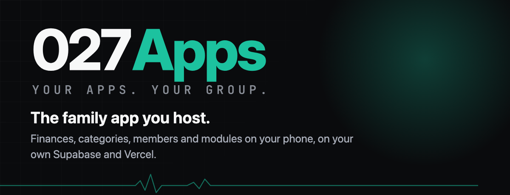
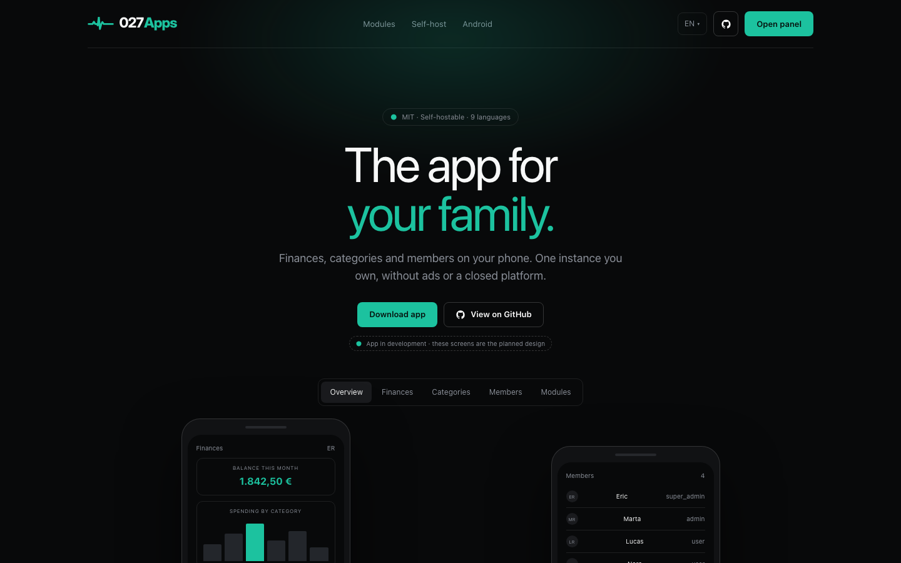
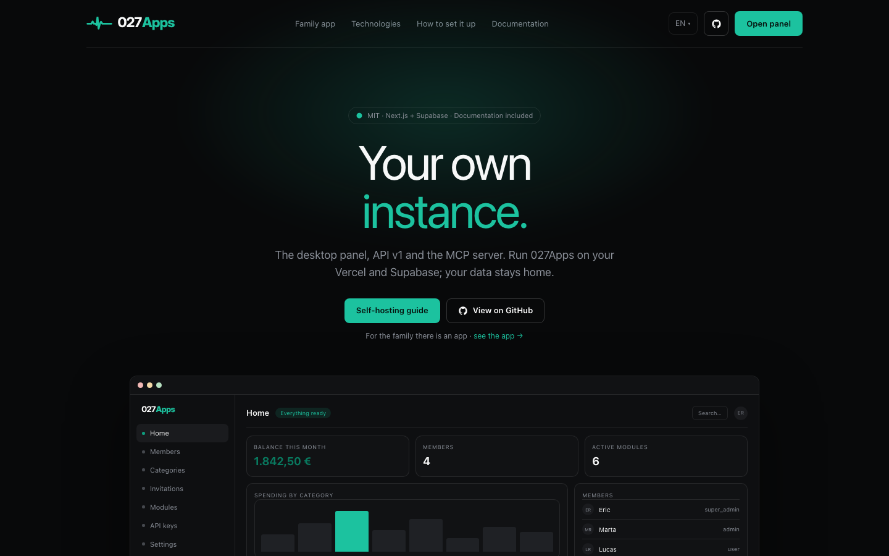
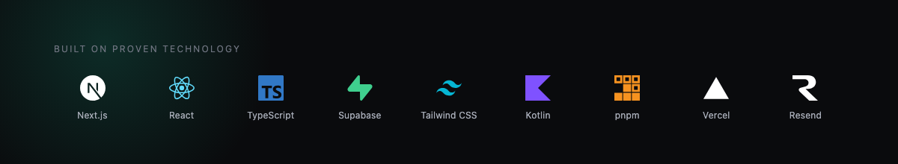

<p align="center">
  
</p>

<p align="center">
  <a href="https://027apps.ericrf.com"></a>
  <a href="LICENSE"></a>
</p>

<h3 align="center">A self-hostable, modular platform for families.</h3>

<p align="center">
  Finances, categories, members and modules on your phone,<br>
  running on your own Supabase and Vercel.
</p>

<p align="center">
  <a href="https://027apps.ericrf.com"><b>027apps.ericrf.com</b></a>
</p>

## Public site

The website presents the product; the panel is where a family runs it.

| Route | Contents |
|---|---|
| [`/`](https://027apps.ericrf.com/) | The family app: modules, screenshots and roadmap. |
| [`/self-host`](https://027apps.ericrf.com/self-host) | The project: admin panel, API v1, MCP, stack and setup. |
| `/l/<locale>` | The same pages in the eight translated languages. |
| `/panel` | The administration panel (invitation-only, requires a session). |

APKs are published on [GitHub Releases](https://github.com/rferic/027apps/releases). There is no
public signup: members join with an invitation.

## Screens

<p align="center">
  
</p>

<p align="center">
  
</p>

## Stack

<p align="center">
  
</p>

- **Panel and API** — Next.js 16, React 19, TypeScript and Tailwind CSS on Vercel.
- **Data and auth** — Supabase (Postgres, Auth, Realtime and Storage), with RLS on every table.
- **Mobile** — native Android in Kotlin and Compose, talking only to `/api/v1`.
- **Integrations** — API v1 keys with scopes and an MCP server for agents.
- **Email** — invitations and transactional mail through Resend.

## Modules and the public site

Modules live under `packages/<key>/` and follow the contract in
[`docs/ai/module-system.md`](docs/ai/module-system.md). The public landing is static content:
it never reads the instance database.

**Shipping a module includes updating the public site.** Its catalog entry and both pages (`/`
and `/self-host`) must reflect the new state, description and three features; a module that
becomes available replaces its mockup with a real screenshot using demo data. The canonical
catalog, states and update rules live in [`docs/ai/landing.md`](docs/ai/landing.md). A module is
not done while the landing still shows it as planned after it ships, or as available before it
is.

## Repository structure

- `apps/` — applications (`admin`, Android)
- `packages/` — shared packages, including modules and the i18n catalog
- `docs/` — specifications, plans, flows and tasks

## Commands

```bash
pnpm lint
pnpm tsc
pnpm test
```

## Self-hosting

You can run your own instance on your own accounts. The step-by-step guide covers local
development, Supabase, Vercel, transactional email, GitHub protections, the Android keystore,
optional Firebase/FCM, backups and production activation:

- [Self-hosting guide](docs/self-hosting.md)
- [Infrastructure runbook](docs/infrastructure.md) (Spanish, with recovery scenarios)
- [AI skill for guided setup](.opencode/skills/self-hosting/SKILL.md)

If you use an AI assistant, point it at the `self-hosting` skill: it walks you through the same
phases and never asks for secrets in chat.

## License

[MIT](LICENSE)
